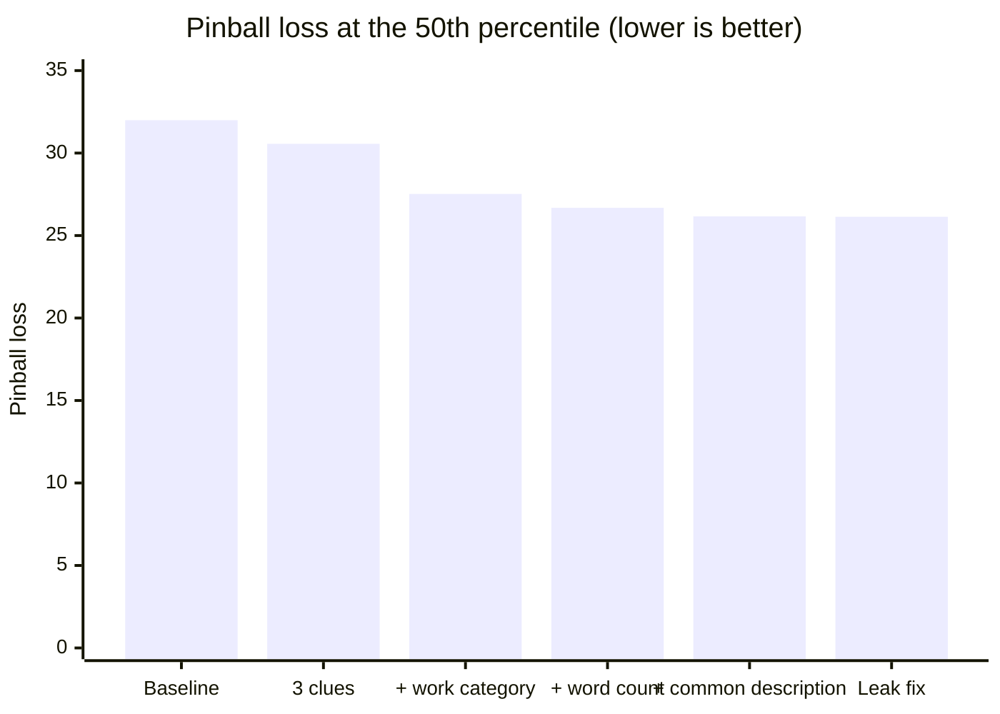

# Results

Every number in this project in one place: the data, the cleaning, the split, the baseline, the model, and how they compare. Numbers were rerun on 2026-11-25. The reasons behind each choice are in [DECISIONS.md](DECISIONS.md).

## The short version

1. I collected **664,069 real building permits** from 5 cities and cleaned them down to **654,574**.
2. For each permit I know how many days it took from applying to getting approved. That's what the model learns to predict.
3. I hid the newest permits (August to October 2026) and made the model forecast them, like a final exam it never studied for.
4. I compared it to a simple guess (the **baseline**): "a permit takes about as long as the same kind of permit did last spring."
5. The model beat the simple guess by **18%** on the typical case and **24 to 27%** on the slow cases.
6. It wins biggest in **Miami and Austin**, the two slowest cities, where planning around the wait matters most.

## Words used here

| Word | Plain meaning |
|---|---|
| Wait | Days from applying for a permit to getting it approved. |
| 50th / 80th / 90th percentile | The typical wait / a slower wait / a slow wait. "90th" means 9 out of 10 permits should finish by then. |
| Baseline | The simple guess the model has to beat. If the model can't beat it, the model is pointless. |
| Clue | Something the model looks at to make its guess, like city, permit type or cost. |
| Train / test | Train = older permits the model learns from. Test = newer permits it never saw, used to grade it. |
| Pinball loss | The grade. Lower is better, like golf. It punishes forecasts that are too low more than ones that are too high on the slow cases. |
| Coverage | How often the real wait came in at or under the forecast. The 90th should be about 90%. |
| Leak | When the model accidentally gets a hint from the test permits. It makes scores look better than they really are. |

## At a glance

| | |
|---|---|
| Permits loaded | 664,069 from 5 cities, issued 2023-01-01 to 2026-10-26 |
| Permits after cleaning | 654,574 (98.6% kept) |
| Train / test | 616,018 issued before 2026-08-01 / 38,556 issued 2026-08-01 to 2026-10-26 |
| Model | `HistGradientBoostingRegressor`, one model each for the 50th, 80th and 90th percentile |
| Clues | city, permit type, work category, cost, description word count, common description |
| Score (pinball loss, lower is better) | **26.14 / 27.97 / 22.15** vs baseline 31.99 / 37.02 / 30.21 |
| Better than the baseline | **18% / 24% / 27%** at the 50th / 80th / 90th |
| Typical forecast off by | 52.3 days on average, vs 64.0 for the baseline |
| Coverage (should be about 50 / 80 / 90%) | 49.5% / 80.0% / 91.0% |

## 1. The data

Pulled from each city's open data API into one Postgres `permits` table. Only permits issued since 2023-01-01.

| City | Source | Permits loaded | Issued through |
|---|---|---|---|
| Austin | Socrata | 217,192 | 2026-10-26 |
| Chicago | Socrata `ydr8-5enu` | 126,314 | 2026-10-26 |
| Orlando | Socrata `ryhf-m453` | 121,069 | 2026-10-21 |
| Miami | ArcGIS `Building_Permits_Since_2014` | 116,635 | 2026-10-26 |
| San Francisco | Socrata `i98e-djp9` | 82,859 | 2026-10-26 |
| **Total** | | **664,069** | |

## 2. Cleaning

All cleaning happens in the `clean_permits` view. The raw table is never changed.

| Rule | Rows it hits |
|---|---|
| Drop negative waits (issued before applied) | 86 |
| Drop waits over 4 years (1,460 days) | 4,010 |
| Drop 3 types that aren't a normal permit wait | 5,747 (Miami recertification 4,307, Chicago reinstate 1,378, Orlando concurrency 62) |
| Permit types under 50 per city become OTHER | 50 rows, kept |
| Cost of $0 or less becomes missing | rows kept |
| En dash in a Chicago type becomes a hyphen | 71,504 rows, kept |

Some rows break more than one rule, so in total **9,495 rows were removed (1.4%)**, leaving **654,574**.

**In plain English:** I threw away less than 2% of the data, only rows that were broken (finished before they started), stale (stuck for over 4 years) or not really a building permit.

| City | Before | After | Kept |
|---|---|---|---|
| Austin | 217,192 | 215,231 | 99.1% |
| Chicago | 126,314 | 124,867 | 98.9% |
| Orlando | 121,069 | 120,917 | 99.9% |
| Miami | 116,635 | 111,081 | 95.2% |
| San Francisco | 82,859 | 82,478 | 99.5% |

## 3. What the clean data looks like

Wait = days from applied to issued.

| City | Permits | Median wait | 80th percentile | 90th percentile | Same day | Has a cost | Has a description | Permit types |
|---|---|---|---|---|---|---|---|---|
| Miami | 111,081 | 62 | 235 | 426 | 4.8% | 97.1% | yes | 16 |
| Austin | 215,231 | 27 | 181 | 357 | 4.9% | 10.0% | yes | 5 |
| Chicago | 124,867 | 4 | 35 | 82 | 33.0% | 89.3% | yes | 8 |
| Orlando | 120,917 | 2 | 31 | 68 | 35.2% | 92.1% | no | 10 |
| San Francisco | 82,478 | 0 | 27 | 95 | 52.3% | 99.6% | yes | 8 |

Miami is the slowest city by far. Its median permit takes about 2 months, and 1 in 10 takes over a year. Over half of San Francisco permits are approved the same day (over the counter).

## 4. Train and test split

Split on **issued date** at 2026-08-01. The model learns from older permits and is graded on newer ones it never saw.

| City | Train (before 8/1) | Test (8/1 to 10/26) |
|---|---|---|
| Austin | 201,205 | 14,026 |
| Chicago | 116,474 | 8,393 |
| Orlando | 115,358 | 5,559 |
| Miami | 104,018 | 7,063 |
| San Francisco | 78,963 | 3,515 |
| **Total** | **616,018** | **38,556** |

**In plain English:** the model studies 94% of the permits (the older ones) and gets tested on the newest 6%, the same way it would have to forecast real future permits.

## 5. How forecasts are scored

- **Pinball loss** (lower is better): for the 90th percentile, a forecast that's too low costs 0.9 per day and one that's too high costs 0.1 per day. That way a forecast can't win by always guessing huge numbers. At the 50th percentile it's exactly half the average error in days.
- **Coverage**: the share of real waits that came in at or under the forecast. The 50th should cover about 50%, the 80th about 80% and the 90th about 90%. Too low means the slow-case number breaks its promise. Too high means it's padded.
- Pinball scores only compare at the same percentile. The 90th scoring lower than the 80th doesn't make it better.

## 6. Baseline

The simple forecast the model has to beat: for each city and permit type, the 50th, 80th and 90th percentile wait of permits issued in the 90 days before the cutoff (42,926 permits, 2026-05-03 to 2026-07-31).

| Percentile | Pinball loss | Coverage |
|---|---|---|
| 50th | 31.99 | 51.5% |
| 80th | 37.02 | 79.5% |
| 90th | 30.21 | 89.7% |

Off by 64.0 days on average at the 50th.

**In plain English:** the simple guess is already decent (its coverage is on target), so to win, the model has to give tighter, more specific forecasts without missing more often.

## 7. How the model got better

Overall pinball loss at each step. Every kept clue improved all 3 percentiles with coverage on target.

**In plain English:** each row is one new clue I gave the model. Work category was the biggest single jump. The scores keep going down, and down is good.

| Step | 50th | 80th | 90th | vs baseline |
|---|---|---|---|---|
| Baseline | 31.99 | 37.02 | 30.21 | |
| Model: city, permit type, cost | 30.56 | 35.10 | 28.54 | 4% / 5% / 6% better |
| + work category | 27.52 | 29.95 | 23.89 | 14% / 19% / 21% better |
| + description word count | 26.68 | 28.79 | 22.86 | 17% / 22% / 24% better |
| + common description (top 60 per city) | 26.16 | 27.90 | 22.02 | 18% / 25% / 27% better |
| Leak fix (lists built from training permits only) | **26.14** | **27.97** | **22.15** | **18% / 24% / 27% better** |



### Clues tried and dropped

| Clue | 50th / 80th / 90th | Why dropped |
|---|---|---|
| Applied month | 31.11 / 36.55 / 29.13 vs 30.56 / 35.10 / 28.54 | Worse at all 3 |
| Applied weekday | 30.58 / 35.22 / 28.61 vs 30.56 / 35.10 / 28.54 | Tie, slightly worse |
| City busyness (permits issued in the prior 30 days) | 30.50 / 34.64 / 28.47 vs 30.56 / 35.10 / 28.54 | Better pinball but coverage fell to 45 / 75 / 86%, and 3 cities got worse |

**In plain English:** not every idea helps. I tried these, measured them, and dropped them because the scores got worse or the forecasts started missing more often.

Applied year was never tried: the split is on issued date, so the year would teach the model that newer permits are faster, which is a leak. Permit status is never an input either: nobody knows it on the day they apply.

## 8. Final model vs baseline, by city

### Pinball loss (lower is better)

| City | 50th | 80th | 90th |
|---|---|---|---|
| Miami | 44.97 vs 57.77 (**22% better**) | 44.13 vs 63.16 (**30%**) | 32.75 vs 48.78 (**33%**) |
| Austin | 34.09 vs 42.63 (**20%**) | 37.57 vs 51.08 (**26%**) | 30.11 vs 42.20 (**29%**) |
| Orlando | 10.93 vs 11.98 (9%) | 12.33 vs 15.17 (19%) | 10.69 vs 13.77 (22%) |
| Chicago | 11.14 vs 12.14 (8%) | 11.60 vs 12.70 (9%) | 9.18 vs 10.24 (10%) |
| San Francisco | 16.40 vs 16.76 (2%) | 21.00 vs 20.97 (tie) | 18.18 vs 18.69 (3%) |
| **All cities** | **26.14 vs 31.99 (18%)** | **27.97 vs 37.02 (24%)** | **22.15 vs 30.21 (27%)** |

```mermaid
xychart-beta
    title "Pinball loss at the 90th percentile by city: baseline (back) vs model (front)"
    x-axis ["Miami", "Austin", "San Francisco", "Orlando", "Chicago"]
    y-axis "Pinball loss" 0 --> 50
    bar [48.78, 42.20, 18.69, 13.77, 10.24]
    bar [32.75, 30.11, 18.18, 10.69, 9.18]
```



The model wins most in the two slowest cities, Miami and Austin, and on the slow-case (80th and 90th) forecasts. San Francisco is close to a tie: over half its permits are same-day and the permit type already says which ones, so the baseline is already good there.

### Coverage (target 50 / 80 / 90%)

| City | Model 50th | Model 80th | Model 90th | Baseline 50th | Baseline 80th | Baseline 90th |
|---|---|---|---|---|---|---|
| Austin | 50.4% | 82.8% | 93.2% | 52.4% | 80.1% | 91.7% |
| Chicago | 45.5% | 77.3% | 89.4% | 51.8% | 79.1% | 88.3% |
| Miami | 56.2% | 81.7% | 90.9% | 49.7% | 80.1% | 89.2% |
| Orlando | 46.7% | 76.6% | 89.1% | 54.0% | 80.8% | 89.0% |
| San Francisco | 46.6% | 77.6% | 89.4% | 47.3% | 75.1% | 87.5% |
| **All cities** | **49.5%** | **80.0%** | **91.0%** | **51.5%** | **79.5%** | **89.7%** |

Overall coverage is on target. By city, Chicago and Orlando run a little low at the 80th (about 77%), so their slow-case forecasts are slightly optimistic.

**In plain English:** when the model says "9 out of 10 permits like yours finish within X days," that's true about 9 out of 10 times. It isn't just a better score on paper; the promise holds.

## 9. Checks that the gains are real

**Practice test.** Seven versions of the model were graded on the same Aug to Oct test, which risks tuning to those exact permits. So the kept clues were checked again on months they were never picked on: train before 2026-05-01 (572,422 permits), test May to July 2026 (43,596).

| Percentile | 3 clues | 6 clues | Better by (practice) | Better by (real test) |
|---|---|---|---|---|
| 50th | 31.22 | 26.61 | 15% | 14% |
| 80th | 36.18 | 28.73 | 21% | 21% |
| 90th | 29.24 | 22.69 | 22% | 23% |

Every city improved on the practice test too, and coverage stayed on target (52.0%, 81.1%, 91.3%).

**In plain English:** the clues worked just as well on a different set of months, so the model didn't just get lucky on one test.

**Leak fix (2026-11-25).** The common-description list and the rare work category rule were first built from all permits, test months included. They're now built from training permits only. Scores moved by less than 0.15 (26.16 / 27.90 / 22.02 before, 26.14 / 27.97 / 22.15 after), so the leak was real but tiny.

**Spot check through the API.** 20 random real permits issued after 8/1 (Miami, Orlando, Chicago) sent through `/forecast`: 19 of 20 came in under the 90th, 18 of 20 under the 80th, 12 of 20 under the 50th. The one miss was a complex 3-story demolition in Chicago (actual 76 days, 90th forecast 73), which the model can't tell apart from a simple demolition.

## 10. Known limits

- Common descriptions only help where people type the same words. The top 60 per city cover 58% of Miami permits but only 17% of Austin, 13% of San Francisco and 6% of Chicago ("REROOF", "RE-ROOFING" and "REROOFING" count as different). This is what the LLM description step is meant to fix.
- Only 10% of Austin permits have a cost, so Austin forecasts lean on permit type and work category.
- Orlando has no descriptions, and its same-day permits are spread across broad types, so Orlando forecasts are less sure.
- The "permit types under 50 become OTHER" rule in the SQL view still counts all months, including the test months. It touches 50 rows.
- The split date is fixed at 2026-08-01 so scores stay comparable while testing ideas. The live model should later be retrained on all permits, with the date moving forward over time.

## How to reproduce

```
.venv\Scripts\python ml\baseline.py
.venv\Scripts\python ml\train.py
```

Both need the `permits` database with the `clean_permits` view (`sql/migrations/`). `train.py` also saves the 3 models and the lists `/forecast` uses to `models/`.
